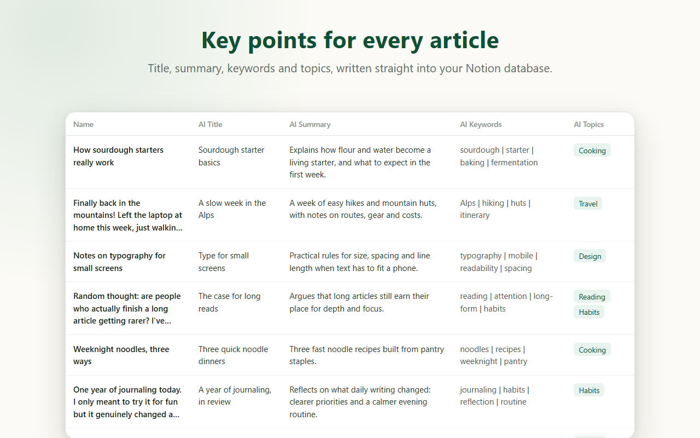
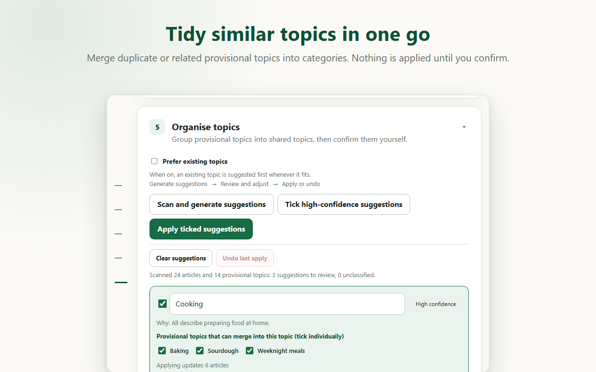

# Siftly

**AI Content Organiser for Notion**

[正體中文（臺灣）](README.md)

Contents to summaries. Clutter to categories.

Articles keep piling up in Notion, but they rarely get organised. Over time the database becomes a long list nobody scrolls through, and finding one piece depends on remembering it.

Siftly is a Chrome extension that helps you make sense of the pile. It reads the articles in your Notion database, writes a title, summary and keywords for each, then groups similar topics into categories for you to confirm. The AI only does the first pass; how things get sorted is up to you.

## Who it's for

- You save many articles, reading notes, research materials or social posts, and want to know at a glance what each one is about.
- You'd rather filter by topic than scroll through hundreds of entries.
- You don't want to tidy everything by hand, but you don't want AI deciding your categories either.

## What it does

- **Writes titles, summaries and keywords**: analyse the current page, or process every article marked as pending in one batch.
- **Organises topics**: merges similar or duplicate topics into categories, which you confirm, edit or discard.
- **Works in English and Traditional Chinese**: the interface and the AI output are each set independently. Switching languages doesn't translate existing content.
- **Uses your own AI**: bring your Google AI Studio or Vertex AI key, choose a model, adjust lengths and customise how summaries are written.

`AI Provisional Topics` is the AI's first suggestion; `AI Topics` is the final category you have confirmed.

Column names follow the interface language in use when Siftly first created them. A database set up in the Chinese interface keeps the names `AI 暫定主題` and `AI 主題`.

### About Chinese output wording

Chinese output is requested in Traditional characters, with Taiwan wording as the target. This is an instruction to the AI and can’t guarantee every output follows it. Traditional Chinese wording varies by region, and the prompt is currently tuned for Taiwan only. Names, quotations and people’s own words in the source are kept as written. You can edit any result in Notion.

## Getting started

### Before you begin

- Google Chrome and the Notion web app.
- A Notion database that holds your articles, and a Notion Integration Token with access to it.
- An API key for Google AI Studio or Vertex AI.

### Install

1. Download a version from GitHub **Releases** (or **Code → Download ZIP**) and extract it to a permanent folder.
2. Open `chrome://extensions` in Chrome and enable **Developer mode**.
3. Click **Load unpacked** and select the folder containing `manifest.json`.

Manually installed versions don't update automatically. To update, replace the files and click **Reload** on the same page.

### First-time setup

1. In Notion, create an Internal Integration and share your database with it through `Add connections`.
2. Open the Siftly settings page, paste the token, load and select your database, then click **Connect database**.
3. Choose an AI provider and model, paste the API key, then click **Save and test AI connection**.
4. Click **Create Siftly fields** to add whatever properties the database is missing. Existing properties are never renamed or overwritten; new ones are named in the interface language at that moment.

If your database isn't listed, check that it is shared with the Integration, or paste its URL under advanced settings.

### Everyday use

1. In settings, use `Prepare articles to analyse` to pick articles and click `Add to pending`. You can also set an article's `Processing Status` to `Pending` directly in Notion.
2. Open Siftly to analyse the current page, or start a batch. Batches can be paused and resumed, and failed items can be retried.
3. Use topic organisation to review the AI's category suggestions, then confirm or edit them before applying.

> **Note**: reanalysing a single page overwrites its existing AI results and clears its confirmed `AI Topics`. You'll need to confirm its category again.

## Privacy

Article text goes straight to the AI provider you chose, and the results are written back to your Notion. Images, video and files are not analysed. Siftly has no server of its own and no tracking.

Before using Google AI Studio's unpaid service, please read the [privacy policy](PRIVACY.md).

## About

Conceived and maintained by Penny Hsieh, with implementation and documentation developed primarily with assistance from OpenAI Codex. Licensed under the [MIT License](LICENSE).

Siftly is an independent open-source tool and is not affiliated with Notion or Google. All names and trademarks belong to their respective owners.
