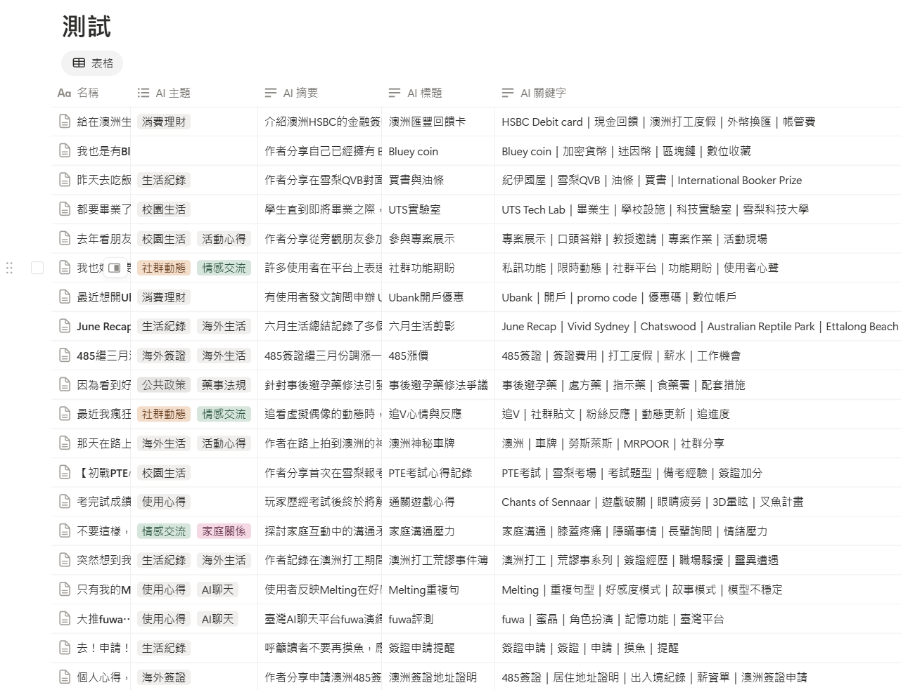
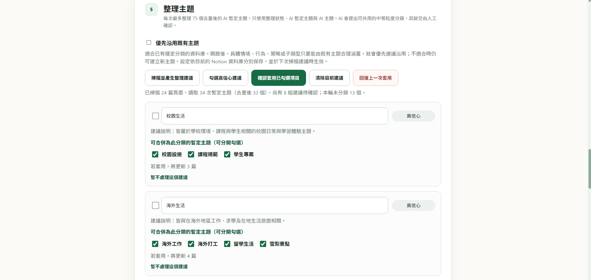

# Siftly

**Notion x AI 內容整理工具**

[English](README.en.md)

讓 AI 先幫你快速整理，最終分類由你決定。

存了一堆資料進 Notion ，時間一長，資料庫變成一大串看不完的清單，連找資訊都只能靠印象。

Siftly 是 Chrome 擴充功能，負責把這堆文章理出頭緒：讀取 Notion 裡的文章，替每篇寫好標題、摘要與關鍵字，再把相近的主題收成分類，交給你確認。考慮到每人的分類偏好不同，AI 只做初步整理，最後怎麼分類交由使用者決定。

## 適合這樣用

- 收藏了很多文章、閱讀筆記、研究資料或社群貼文，想快速知道每篇在講什麼。
- 想用主題篩選，而不是在幾百筆資料裡一直往下滑。
- 不想一篇篇手動整理，但也不想讓 AI 完全決定分類。
- 已經有初步分類構想，手動加入後，讓 AI 優先按照你的分類去做。

## 能做什麼

- **自動寫標題、摘要、關鍵字**：分析目前的頁面，或一次處理所有「待分析」的文章。
- **整理主題**：把相近或重複的主題合併成分類，由你確認、修改或捨棄。
- **中英文都能用**：介面與 AI 輸出各自選擇正體中文或英文；切換語言不會翻譯既有內容。
- **用自己的 AI**：使用你的 Google AI Studio 或 Vertex AI 金鑰，可選模型、調整字數、自訂摘要的寫法。

「AI 暫定主題」是 AI 給的初步建議；「AI 主題」才是你確認後的正式分類。

### 關於中文輸出的用語

中文輸出會請 AI 使用**正體字，並以臺灣慣用語為目標**，這是對 AI 的要求，無法保證每次輸出都符合。正體中文在各地用詞有差異，目前僅針對臺灣用語調整提示詞。原文中的專有名詞、引文與人物原話會盡量保留原貌。所有結果都可以在 Notion 中自行修改。

## 開始使用

### 事前準備

- Google Chrome，以及 Notion 網頁版。
- 一個存放文章的 Notion 資料庫，和一組可存取它的 Notion Integration Token。
- Google AI Studio 或 Vertex AI 的 API Key。

### 安裝

1. 從 GitHub 的 **Releases** 下載版本（或 **Code → Download ZIP**），解壓縮到固定的資料夾。
2. 在 Chrome 開啟 `chrome://extensions`，啟用「開發人員模式」。
3. 按「載入未封裝項目」，選擇內含 `manifest.json` 的資料夾。

手動安裝的版本不會自動更新。換新版時，請替換檔案後在同一頁按「重新載入」。

### 第一次設定

1. 在 Notion 建立 Internal Integration，並在你的資料庫用 `Add connections` 分享給它。
2. 開啟 Siftly 設定頁，貼上 Token，載入並選擇資料庫，按「連接資料庫」。
3. 選擇 AI 服務與模型，貼上 API Key，按「儲存並測試 AI 連線」。
4. 按「建立 Siftly 欄位」，補上資料庫缺少的欄位。既有欄位不會被改名或覆寫；新欄位的名稱會跟著當時的介面語言。

找不到資料庫時，請先確認已分享給 Integration，也可以在進階設定貼上資料庫網址。

### 日常使用

1. 在設定頁的「準備待分析文章」選出要分析的文章，按「加入待分析」；也可以直接在 Notion 把文章設為「待分析」。
2. 開啟 Siftly，分析目前的頁面，或開始批次分析。批次可以暫停、繼續，失敗的項目也能重試。
3. 用主題整理檢視 AI 的分類建議，確認或修改後套用。

> **注意**：重新分析單一頁面，會覆寫它原本的 AI 分析結果，並清除已確認的「AI 主題」，需要重新確認分類。

## 隱私

文章的純文字會直接送到你選擇的 AI 服務，結果寫回你的 Notion。圖片、影片與檔案不會被分析。Siftly 沒有自己的伺服器，也沒有任何追蹤。

使用 Google AI Studio 的未付費服務前，請先閱讀[隱私權政策](PRIVACY.zh-TW.md)。

## 關於

由 Penny Hsieh 發想與維護，程式實作與文件整理主要由 OpenAI Codex 協助完成。採用 [MIT License](LICENSE)。

Siftly 是獨立的開源工具，與 Notion、Google 沒有關聯，各名稱與商標屬於其所有人。
